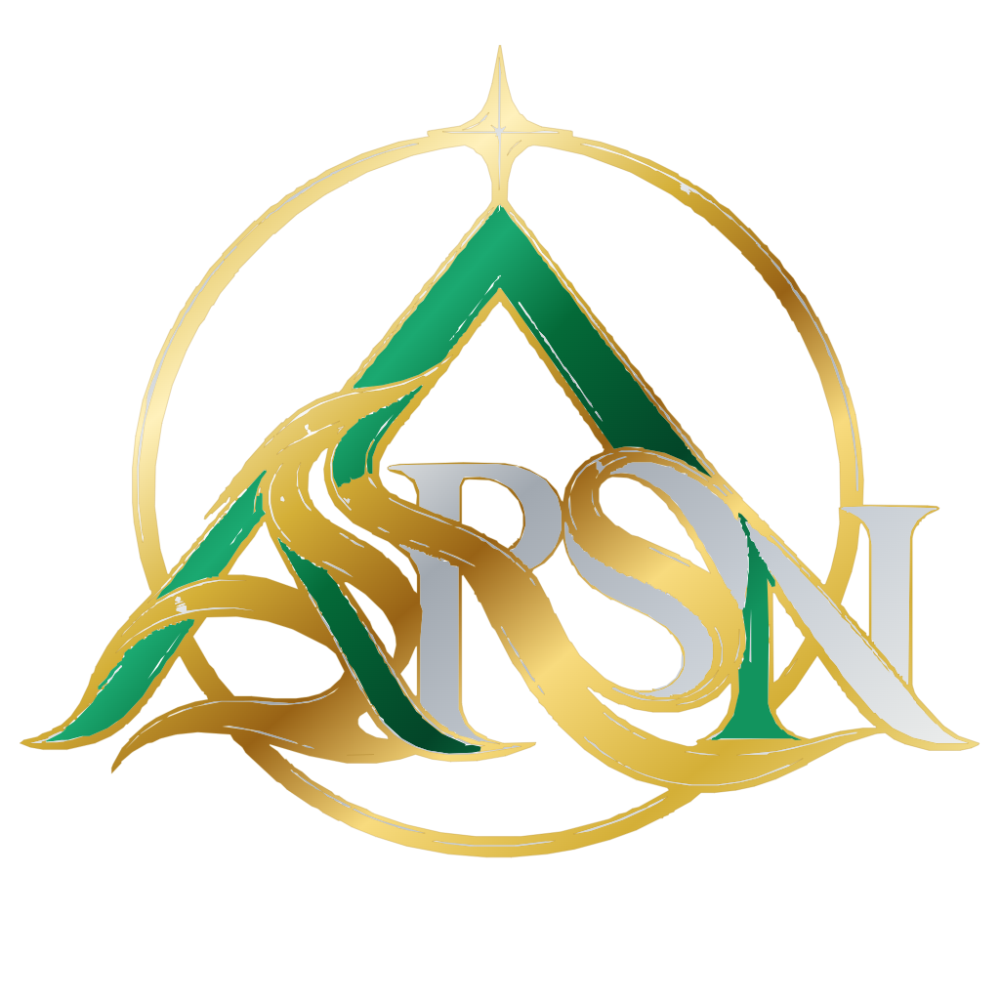

<h1 align="center">Amalakanti Siva Rama Surya Nandh</h1>

  M.Tech graduate in Artificial Intelligence & Data Science 
  Building reproducible deep-learning and computer-vision systems

## About me

I am an M.Tech graduate focused on practical artificial intelligence, deep learning, and computer
vision. I enjoy turning research ideas into clear, testable software with documented assumptions,
reproducible experiments, and honest evaluation.

## Featured project

### [A Label-Free Deep Learning Framework for Image Fusion](https://github.com/AmalakantiSivaRamaSuryaNandh/label-free-deep-learning-image-fusion)

A self-supervised image-fusion system that learns common and unique feature decomposition without
manually labelled fused targets. It includes a PyTorch CUD-inspired network, classical baselines,
a Streamlit demonstration, reproducible evaluation tools, automated tests, and GitHub Actions CI.

**Applications:** multi-focus, multi-exposure, and infrared-visible image fusion.

## Technical focus

- Deep learning and self-supervised learning
- Computer vision and image processing
- Reproducible machine-learning experiments
- Python applications, testing, and continuous integration

## Toolkit

## Current goals

- Complete controlled image-fusion experiments on public benchmark datasets
- Strengthen task-specific evaluation and statistical reporting
- Continue building reliable AI projects with clean documentation and tests

## Connect

Explore my repositories here on GitHub or follow the featured project for updates.

## Website and identity

- Website: [asrsn.me](https://asrsn.me/)
- Public contact: [contact@asrsn.me](mailto:contact@asrsn.me)
- Shared logo files and usage guidance: [ASRSN brand assets](brand/README.md)

The website is served by GitHub Pages from the repository root. Keep `CNAME` as `asrsn.me`.
